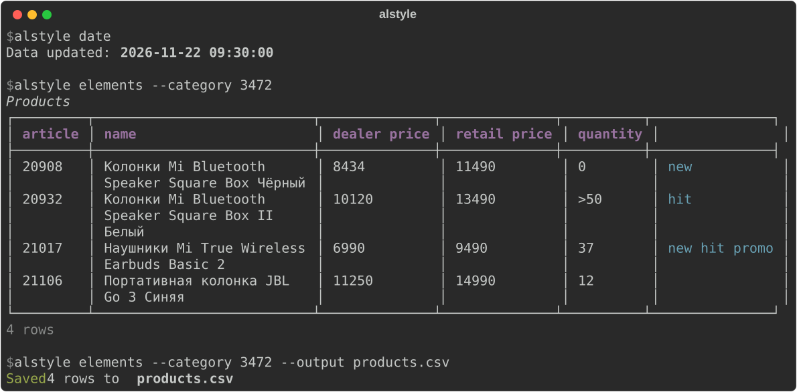

<div align="center">

# 🛒 al-style-api

**A Python client and a command line tool for the Al-Style dealer API.**

Al-Style is a distributor of electronics in Kazakhstan. Its dealer API gives
the catalog with dealer and retail prices, stock and photos, for syncing an
online store. This tool loads categories and products, shows them as tables,
saves them to CSV for Excel or to JSON, and downloads product photos.

[](https://github.com/mredwardlik/al-style-api/actions/workflows/tests.yml)




</div>

---

> [!NOTE]
> The tool was written in 2019 for a store that worked with Al-Style. As of
> 2026 the documented address `order.al-style.kz` no longer resolves, so the
> tests run against a mocked API. If the API has moved, point the tool to the
> new address with `--url` or `ALSTYLE_URL`.

## ✨ Features

- 📦 **Every API method**: data date, category tree, products page by page or
  all at once, full product info, stock, photos
- 📊 **Tables in the terminal**: prices, stock and the new / hit / promo marks;
  categories indented by their depth in the tree
- 📄 **CSV for Excel**: semicolons and a UTF-8 BOM, so Excel opens Cyrillic
  text in the right columns. Or JSON with `-o file.json`
- 🖼 **Photo download** in parallel, named `article_1.jpg`, `article_2.jpg`…
- 🔑 **No token in the code**: it comes from an option, an environment
  variable or a config file
- 🛡 **Clear errors**: a wrong token, a timeout or an unreachable host give one
  line of explanation instead of a traceback

## 🚀 Installation

```bash
pip install git+https://github.com/mredwardlik/al-style-api.git
alstyle config --token YOUR_ACCESS_TOKEN
```

Python 3.10 or newer. The token is saved to `~/.alstyle.ini`. It is looked
for in this order:

1. the `--token` option;
2. the `ALSTYLE_TOKEN` environment variable;
3. `alstyle.ini` in the current folder;
4. `~/.alstyle.ini`.

The address works the same way: `--url`, `ALSTYLE_URL` or `url =` in the
file.

```ini
[alstyle]
token = YOUR_ACCESS_TOKEN
url = https://order.al-style.kz/api
```

## 💻 Usage

```bash
alstyle date                                    # when the data was updated
alstyle categories                              # the category tree
alstyle categories -o categories.csv            # ... saved for Excel

alstyle elements -c 3638                        # first 100 products of a category
alstyle elements -c 3638,3639 --all -o all.csv  # every product of two categories
alstyle elements --all -f brand,url,barcode -o catalog.json

alstyle info 20908,20932 -f detailtext,properties
alstyle quantity 20908,20932
alstyle images 20908 --download photos          # photo links and the files
alstyle articles -c 3638                        # 20908,20932,...
```

| Option             | Meaning                                                    |
| ------------------ | ---------------------------------------------------------- |
| `-o`, `--output`   | save to `.csv` or `.json` (add `--show` to print too)      |
| `--json`           | print the raw JSON answer, for `jq` and scripts            |
| `-f`, `--fields`   | additional fields: `description`, `brand`, `weight`, `warranty`, `images`, `url`, `model`, `barcode`; for `info` also `detailtext`, `properties` |
| `-a`, `--all`      | load every page (the API gives at most 100 per request)    |
| `--delay`          | pause between requests, in seconds                         |
| `--url`, `--token` | the address and the token for one run                      |

`alstyle COMMAND --help` lists every option. The full API reference, in
Russian, is in [docs/api.md](docs/api.md).

## 🐍 Python API

```python
from alstyle import ApiError, Client

client = Client('YOUR_ACCESS_TOKEN')          # url=..., timeout=30, delay=0
client.date()                                 # '2017-12-11 23:16:00'
client.categories()                           # [{'id': 3633, 'name': ..., 'level': 1, ...}, ...]
client.elements(3638, limit=100, offset=0, fields=['brand'])
for product in client.all_elements([3638, 3639]):
    print(product['article'], product['price2'])
client.element_info([20908, 20932], fields=['detailtext'])
client.quantity(20908)                        # {'20908': '>50'}
client.images(20908)                          # {'20908': ['http://img.al-style.kz/...jpg', ...]}
```

```python
from alstyle import export

export.write_csv(client.elements(3638), 'products.csv')
export.download_images(client.images([20908, 20932]), 'photos', workers=5)
```

Errors of the network and the API raise `ApiError`, wrong arguments raise
`ValueError`.

## 🗂 Project structure

```text
al-style-api/
├── alstyle/
│   ├── client.py   # Client: requests, paging, answers made uniform
│   ├── export.py   # CSV, JSON, photo download
│   ├── config.py   # token and address from options, environment, files
│   └── cli.py      # the alstyle command
├── docs/api.md     # API reference (Russian)
└── tests/          # pytest with a mocked API
```

## 🧪 Tests

```bash
pip install -e ".[dev]"
pytest
```

The API is mocked with [responses](https://github.com/getsentry/responses).
The tests check the query parameters of every method, paging, both answer
shapes of `/images` and `/quantity`, HTTP and network errors, the CSV format
and photo download, and the token lookup order.
